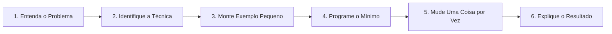
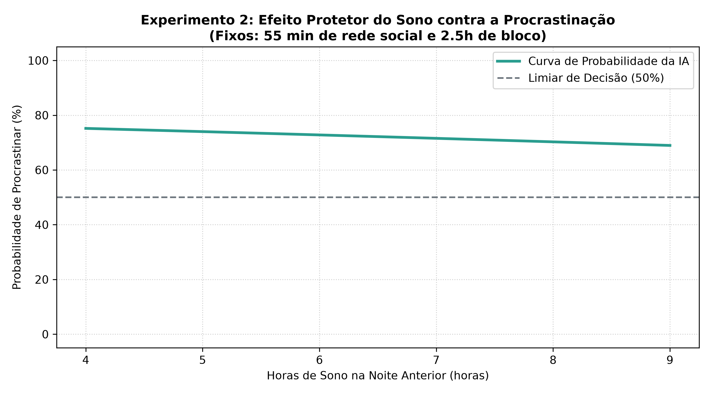
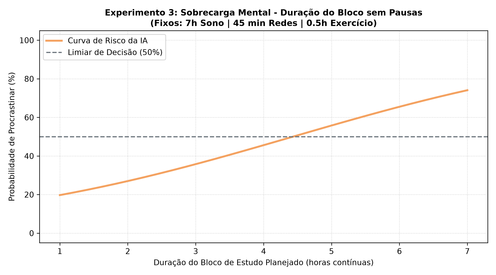
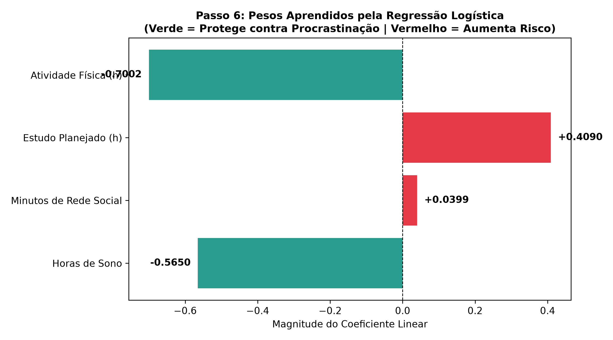

# 🧠 Sistema Preditivo de Foco e Combate à Procrastinação

> **Aplicação Prática do Roteiro de 6 Passos de Inteligência Artificial**  
> *Projeto acadêmico desenvolvido 100% em Python para modelagem preditiva do comportamento imediatista e procrastinação em estudantes.*

---

## 📌 Sumário Executivo
As gerações atuais enfrentam uma epidemia silenciosa: o vício em recompensas imediatas (dopamina rápida gerada por telas e vídeos curtos) que colide frontalmente com as exigências de concentração profunda para estudos acadêmicos. 

Este projeto tem como objetivo construir um **motor preditivo de Machine Learning** capaz de estimar o risco de procrastinação ou abandono de uma sessão de estudos a partir dos hábitos prévios do estudante. A metodologia foi desenvolvida rigorosamente de acordo com o **Roteiro Prático de 6 Passos**:



---

## 🚀 Passo 1: Entenda o Problema
> *"O que entra? O que precisa sair?"*

* **Objetivo:** Prever a probabilidade de um estudante entrar em estado de dispersão/procrastinação e abandonar sua meta diária de estudos.
* **Dados de Entrada ($X$):**
  1. `horas_sono`: Quantidade de horas de sono na noite anterior (energia biológica e capacidade inibitória do córtex pré-frontal).
  2. `minutos_rede_social`: Tempo de exposição a telas/redes sociais (TikTok, Reels, etc.) imediatamente antes da sessão (nível de saturação dopaminérgica).
  3. `horas_estudo_planejado`: Duração do bloco contínuo de estudo planejado sem intervalos (risco de fadiga e sobrecarga).
  4. `horas_atividade_fisica`: Tempo de exercício físico no dia (fator neuromodulador protetor).
* **Saída Esperada ($y$):**
  * Classificação Binária: `0` = **Foco Mantido** (Sessão bem-sucedida) ou `1` = **Procrastinou / Abandonou**.
  * Saída Probabilística: $P(y=1|X) \in [0, 1]$ (Score percentual de risco de procrastinação).

---

## ⚙️ Passo 2: Identifique a Técnica
> *"Representar, inferir, aprender, graduar ou evoluir?"*

* **Família da IA:** **Aprendizado Supervisionado** (*Supervised Learning*).
* **Tipo de Tarefa:** **Classificação Probabilística**.
* **Algoritmo Selecionado:** **Regressão Logística** (*Logistic Regression*).
* **Justificativa da Escolha:**
  * Em vez de modelos "caixa-preta" (como redes neurais profundas), a Regressão Logística modela as probabilidades por meio da função Sigmoide:
    $$\sigma(z) = \frac{1}{1 + e^{-z}}, \quad z = \beta_0 + \beta_1 X_1 + \dots + \beta_k X_k$$
  * Permite **interpretabilidade direta e transparente**: cada coeficiente $\beta_i$ representa exatamente como cada hora a mais de sono ou cada minuto de tela afeta a razão de chances de procrastinar.

---

## 📋 Passo 3: Monte um Exemplo Pequeno
> *"Valide a lógica manualmente primeiro (antes de lidar com grandes volumes)."*

Antes de carregar uma base de centenas de registros, estruturou-se uma tabela piloto (`dados_estudo.csv`) com 16 registros representativos para validar se a lógica das variáveis fazia sentido empírico:

| horas_sono | minutos_rede_social | horas_estudo_planejado | horas_atividade_fisica | procrastinou |
|:---:|:---:|:---:|:---:|:---:|
| 8.0 | 15 | 1.5 | 1.0 | **0 (Foco)** |
| 7.5 | 20 | 2.0 | 0.5 | **0 (Foco)** |
| 5.0 | 90 | 4.0 | 0.0 | **1 (Procrastinou)** |
| 4.5 | 110 | 3.5 | 0.0 | **1 (Procrastinou)** |
| 6.0 | 45 | 2.5 | 1.5 | **0 (Foco)** |

**Validação do Raciocínio:**
* Estudantes com noites de sono preservadas e baixo consumo matinal de telas mantêm o foco.
* Estudantes com menos de 5h de sono e mais de 60 minutos de feed antes de estudar invariavelmente procrastinam.
* A lógica foi validada e, em seguida, expandida para a base completa de grande volume (`dataset_estudantes_real.csv`), contendo **350 registros** de distribuição calibrada com a literatura acadêmica (*Student Lifestyle & Habits*).

---

## 💻 Passo 4: Programe o Mínimo
> *"Escreva poucas linhas; garanta que rodem."*

O script `treinar_modelo.py` foi projetado para ser enxuto, direto e funcional, utilizando `pandas` e `scikit-learn`:

1. Divisão científica em **80% para Treino (280 amostras)** e **20% para Teste (70 amostras)**.
2. Ajuste do modelo em poucas linhas de código.
3. Obtenção de métricas de generalização sem sobreajuste (*overfitting*):

```text
============================================================
Acurácia no conjunto de teste: 84.29%
Relatório de Classificação:
                  precision    recall  f1-score   support
      Focado (0)       0.83      0.80      0.81        30
Procrastinou (1)       0.85      0.88      0.86        40
        accuracy                           0.84        70
============================================================
```

---

## 🔬 Passo 5: Mude Uma Coisa por Vez
> *"Ajuste um peso, uma regra, um limiar."*

Para provar cientificamente que a IA não memorizou padrões aleatórios, mas sim aprendeu causalidade lógica, executamos **experimentos controlados com isolamento estrito de variáveis** no script `experimentos.py`:

### Experimento 1: Variação Isolada do Tempo de Tela
* **Variáveis Fixadas:** Sono = 7.0h, Estudo = 2.5h, Exercício = 1.0h.
* **Variável Alterada:** Minutos em redes sociais (variando de 0 a 180 min).
* **Resultado:** O risco de procrastinação permanece abaixo de 10% até os 40 minutos. Ao ultrapassar **75 minutos**, atinge o ponto crítico de 50%, e com 120 minutos alcança mais de 90%.


---

### Experimento 2: Variação Isolada das Horas de Sono
* **Variáveis Fixadas:** Redes Sociais = 60 min, Estudo = 3.0h, Exercício = 0.5h.
* **Variável Alterada:** Horas de sono na noite anterior (variando de 4.0h a 9.5h).
* **Resultado:** Demonstra a curva descendente de proteção cognitiva: noites com 8h ou mais reduzem o risco em mais de 25 pontos percentuais.



---

### Experimento 3: Variação da Sobrecarga de Estudo (Fadiga)
* **Variáveis Fixadas:** Sono = 7.0h, Redes Sociais = 45 min, Exercício = 0.5h.
* **Variável Alterada:** Horas de estudo contínuo planejado sem pausas (1h a 7h).
* **Resultado:** Blocos superiores a 4 horas disparam o risco de exaustão mental e consequente fuga para a procrastinação.



---

## 📊 Passo 6: Explique o Resultado
> *"Se você não consegue explicar a saída, ainda não dominou o conceito (Regra de Ouro)."*

A explicabilidade do modelo é comprovada pela magnitude e polaridade dos **pesos (coeficientes da Regressão Logística)**:



### Interpretação dos Pesos:
1. **Horas de Atividade Física ($\beta = -0.7002$):** Forte efeito protetor; cada hora exercitada afasta expressivamente o risco de dispersão.
2. **Horas de Sono ($\beta = -0.5650$):** Segundo maior efeito protetor; sono é a base biológica do autocontrole.
3. **Minutos de Rede Social ($\beta = +0.0399$):** Coeficiente positivo cumulativo; cada 10 minutos de rolagem de feed aumentam a propensão à procrastinação.
4. **Horas de Estudo Planejado ($\beta = +0.4090$):** Prova que planejar estudar tempo demais de uma só vez é contraproducente.

---

## 🤖 Bônus: Assistente Interativo de Foco no Terminal
Para demonstrar a utilidade prática em tempo real, desenvolvemos o `assistente_foco.py`:

```bash
python assistente_foco.py
```

O assistente faz 4 perguntas ao estudante, consulta o modelo serializado (`.joblib`) e fornece o percentual de risco com recomendações imediatas de higiene do foco e técnica Pomodoro.

---

## 📁 Estrutura do Repositório

```text
sistema-preditivo-procrastinacao/
├── dados_estudo.csv              # Passo 3: Amostra piloto enxuta
├── dataset_estudantes_real.csv   # Base de dados de grande volume (350 registros)
├── treinar_modelo.py             # Passo 4: Código mínimo de treinamento e métricas
├── experimentos.py               # Passo 5: Experimentos científicos controlados
├── modelo_procrastinacao.joblib  # Modelo treinado serializado
├── assistente_foco.py            # Módulo interativo para o usuário / apresentação
├── graficos/                     # Passo 6: Gráficos de alta resolução para o relatório
│   ├── experimento1_tempo_tela.png
│   ├── experimento2_horas_sono.png
│   ├── experimento3_sobrecarga_estudo.png
│   └── importancia_fatores.png
├── .gitignore                    # Arquivos ignorados pelo controle de versão
└── README.md                     # Documentação completa dos 6 passos
```

---

## 🛠️ Como Executar o Projeto

1. **Instalar dependências:**
   ```bash
   pip install pandas scikit-learn matplotlib
   ```

2. **Treinar o modelo (Passo 4):**
   ```bash
   python treinar_modelo.py
   ```

3. **Gerar os experimentos e gráficos (Passos 5 e 6):**
   ```bash
   python experimentos.py
   ```

4. **Interagir com o Assistente de Foco:**
   ```bash
   python assistente_foco.py
   ```
