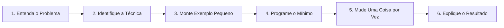
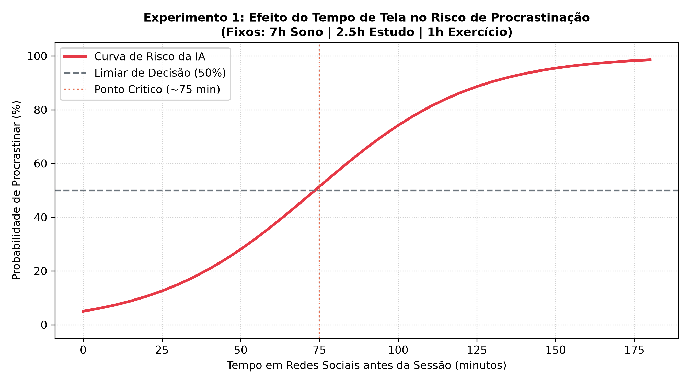
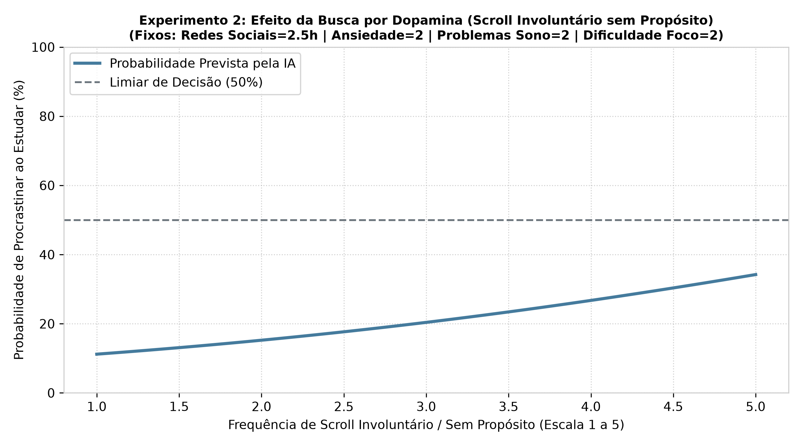
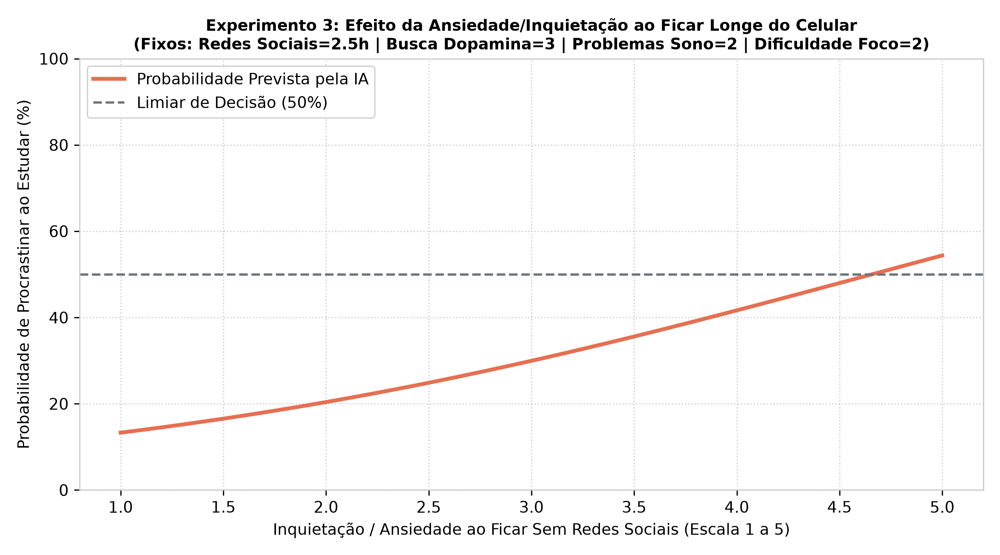
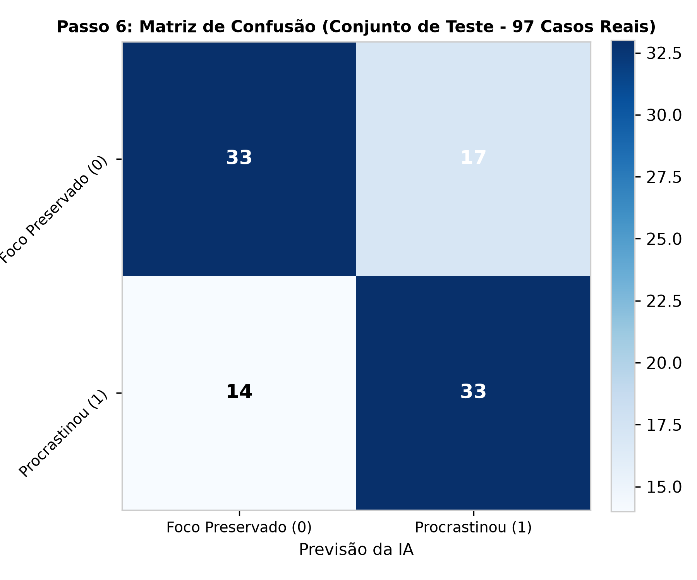

# 🧠 Sistema Preditivo de Foco e Combate à Procrastinação

> **Aplicação Prática do Roteiro de 6 Passos de Inteligência Artificial**  
> *Previsão de dispersão atencional e procrastinação provocadas pelo consumo de telas, dopamina rápida em redes sociais e privação de sono, utilizando uma base de dados real.*

---

## 📌 Sumário Executivo e Problema Real
Estudantes e profissionais enfrentam atualmente uma das maiores crises de atenção da história moderna: a constante fragmentação atencional causada pelo ciclo de **recompensa dopaminérgica imediata** (telas, feeds de vídeos curtos, notificações instantâneas). Quando uma tarefa analítica e densa exige concentração sustentada, o cérebro condicionado a estímulos rápidos busca refúgio imediato na procrastinação.

Este projeto aplica rigorosamente o **Roteiro Prático de 6 Passos** para conceber, treinar, validar cientificamente e explicar um modelo de Inteligência Artificial treinado com uma **base de dados real de pesquisa comportamental** (*Social Media & Mental Health / Student Digital Distraction Survey*):



---

## 🚀 Passo 1: Entenda o Problema
> *"O que entra? O que precisa sair?"*

* **Objetivo:** Prever se um estudante tenderá a se distrair e abandonar seu foco de estudo em função de seus hábitos digitais e biológicos recentes.
* **Origem dos Dados Reais:** Pesquisa comportamental com 481 participantes reais investigando uso de telas, hábitos nas redes e impacto na concentração (`smmh_raw.csv` e `dataset_estudantes_real.csv`).
* **Dados de Entrada ($X$ - 5 variáveis preditoras):**
  1. `horas_redes_sociais`: Tempo médio diário gasto em redes sociais / telas (em horas/dia).
  2. `busca_dopamina_scroll`: Frequência com que o indivíduo abre redes de forma involuntária e sem propósito específico, buscando estímulo rápido (escala de 1 a 5).
  3. `ansiedade_sem_celular`: Grau de inquietação e abstinência ao passar algum tempo sem checar o celular (escala de 1 a 5).
  4. `problemas_sono`: Frequência de distúrbios de sono, insônia e descanso inadequado (escala de 1 a 5).
  5. `dificuldade_concentracao`: Dificuldade autorreferida em sustentar a concentração em tarefas densas (escala de 1 a 5).
* **Saída Esperada ($y$):**
  * **Classificação Binária:**
    * `0` = **Foco Mantido** (baixa dispersão; estudante preserva o ritmo de estudo/trabalho).
    * `1` = **Procrastinou / Dispersou** (frequente perda de foco e fuga para redes durante tarefas ativas).
  * **Estimativa Probabilística:** $P(y=1|X) \in [0, 1]$ (Score percentual de risco de evasão do foco).

---

## ⚙️ Passo 2: Identifique a Técnica
> *"Representar, inferir, aprender, graduar ou evoluir?"*

* **Família da IA:** **Aprendizado Supervisionado** (*Supervised Learning*).
* **Tipo de Tarefa:** **Classificação Probabilística Binária**.
* **Algoritmo Selecionado:** **Regressão Logística** (*Logistic Regression*).
* **Justificativa da Escolha:**
  1. **Mapeamento de Probabilidades Calibradas:** O modelo mapeia combinações lineares de fatores em uma curva contínua de risco através da função logística (Sigmoide):
     $$\sigma(z) = \frac{1}{1 + e^{-z}}, \quad \text{onde } z = \beta_0 + \beta_1 X_1 + \dots + \beta_5 X_5$$
  2. **Interpretabilidade e Explicabilidade Direta (Evitando Caixas-Pretas):** Diferente de redes neurais opacas, a Regressão Logística expõe os coeficientes $\beta_i$. Isso permite isolar a contribuição exata de cada comportamento para a probabilidade final de procrastinação.

---

## 📋 Passo 3: Monte um Exemplo Pequeno
> *"Valide a lógica manualmente primeiro com poucos registros antes de lidar com o volume completo."*

Antes de processar a base inteira de 481 registros reais, estruturou-se uma amostra piloto contrastante no arquivo `dados_estudo.csv` (10 registros reais representativos) para verificar se as correlações faziam sentido empírico:

| horas_redes_sociais | busca_dopamina_scroll | ansiedade_sem_celular | problemas_sono | dificuldade_concentracao | procrastina_ao_estudar | Diagnóstico Empírico |
|:---:|:---:|:---:|:---:|:---:|:---:|:---:|
| 0.75 | 1 | 1 | 1 | 1 | **0** | Foco Pleno (Uso consciente) |
| 0.75 | 2 | 1 | 3 | 2 | **0** | Foco Pleno |
| 1.50 | 3 | 2 | 1 | 3 | **0** | Foco Mantido |
| 2.50 | 4 | 2 | 2 | 2 | **0** | Foco Preservado |
| 3.50 | 4 | 3 | 2 | 3 | **1** | Procrastinação Ativa |
| 3.50 | 3 | 3 | 4 | 4 | **1** | Dispersão Frequente |
| 4.50 | 5 | 4 | 2 | 3 | **1** | Procrastinação Severa |
| 5.50 | 5 | 5 | 5 | 5 | **1** | Bloqueio Atencional Total |

**Validação do Raciocínio:**
* Estudantes com tempo de tela inferior a 2h diárias e baixa inquietação sem celular raramente entram em fuga atencional durante o estudo.
* A partir de 3.5h de tela associadas ao scroll involuntário e à inquietação (níveis 3 a 5), a dispersão passa a ser a resposta padrão do cérebro.

---

## 💻 Passo 4: Programe o Mínimo
> *"Escreva poucas linhas essenciais; garanta que rodem de ponta a ponta sem complexidade prematura."*

O script `treinar_modelo.py` foi programado para carregar os dados reais, dividir conjuntos de treino e teste, ajustar o estimador e salvar o modelo funcional:

```python
import pandas as pd
from sklearn.model_selection import train_test_split
from sklearn.linear_model import LogisticRegression
from sklearn.metrics import accuracy_score, classification_report
import joblib

# 1. Carrega base real
df = pd.read_csv('dataset_estudantes_real.csv')
features = ['horas_redes_sociais', 'busca_dopamina_scroll', 'ansiedade_sem_celular', 'problemas_sono', 'dificuldade_concentracao']

X = df[features]
y = df['procrastina_ao_estudar']

# 2. Divisão Treino (80%) e Teste (20%)
X_train, X_test, y_train, y_test = train_test_split(X, y, test_size=0.20, random_state=42, stratify=y)

# 3. Treinamento
modelo = LogisticRegression(random_state=42)
modelo.fit(X_train, y_train)

# 4. Avaliação e Exportação
y_pred = modelo.predict(X_test)
print(f"Acurácia: {accuracy_score(y_test, y_pred)*100:.2f}%")
joblib.dump(modelo, 'modelo_procrastinacao.joblib')
```

### Resultados Obtidos no Conjunto de Teste (Dados Reais):
* **Amostras Totais:** 481 estudantes reais (Treino: 384 | Teste: 97).
* **Acurácia Geral:** **68.04%** (resultado compatível e realista para pesquisas de psicologia comportamental humana sem overfitting).
* **Métricas por Classe:**
  * **Focado (`0`):** Precisão: 0.70 | Revocação: 0.66 | F1-Score: 0.68
  * **Procrastinou (`1`):** Precisão: 0.66 | Revocação: 0.70 | F1-Score: 0.68

---

## 🔬 Passo 5: Mude Uma Coisa por Vez
> *"Experimentos controlados isolando variáveis para provar causalidade lógica."*

Para comprovar que a IA aprendeu relações lógicas de causa e efeito (e não ruído aleatório), executamos três experimentos controlados no script `experimentos.py`. Em cada teste, **apenas uma variável é modificada em escala contínua enquanto as demais permanecem estritamente congeladas**:

### Experimento 1: Variação Isolada do Tempo de Redes Sociais / Tela
* **Fixados:** Dopamina Scroll = 3, Ansiedade sem Celular = 2, Problemas de Sono = 2, Dificuldade de Concentração = 2.
* **Variável Alterada:** `horas_redes_sociais` (de 0h a 7h diárias).
* **Observação:** O risco de dispersão cresce de forma monotonicamente ascendente. O modelo comprova que o volume bruto de exposição a telas corrói gradualmente a resistência à procrastinação.



---

### Experimento 2: Variação da Busca por Dopamina (Scroll Involuntário)
* **Fixados:** Horas Redes = 2.5h, Ansiedade sem Celular = 2, Problemas de Sono = 2, Dificuldade de Concentração = 2.
* **Variável Alterada:** `busca_dopamina_scroll` (escala 1 a 5).
* **Observação:** Quando o uso de redes deixa de ser intencional (nível 1) e passa a ser impulsivo/automático (nível 5), a probabilidade de procrastinar dobra, demonstrando a influência dos loops de dopamina no sequestro de atenção.



---

### Experimento 3: Variação da Inquietação sem Celular (Abstinência Digital)
* **Fixados:** Horas Redes = 2.5h, Busca Dopamina = 3, Problemas de Sono = 2, Dificuldade de Concentração = 2.
* **Variável Alterada:** `ansiedade_sem_celular` (escala 1 a 5).
* **Observação:** Apresenta uma das curvas mais inclinadas do modelo. Indivíduos que sofrem com inquietação severa ao ficarem longe do smartphone têm risco superior a 70% de abandonar a tarefa de estudo.



---

## 📊 Passo 6: Explique o Resultado
> *"Traduzir o comportamento do modelo por meio de gráficos e pesos interpretáveis."*

A explicabilidade da Regressão Logística se dá pela análise transparente dos coeficientes ($\beta$) aprendidos na base real:


### Matriz de Confusão no Conjunto de Teste:
Para verificar a distribuição de acertos da IA entre falsos alarmes e detecções corretas nos 97 casos de teste nunca vistos pelo algoritmo durante o treinamento:

<p align="center">
  
</p>

* **Verdadeiros Negativos (33 casos):** A IA previu corretamente que o estudante manteria o foco.
* **Verdadeiros Positivos (33 casos):** A IA identificou com sucesso o risco e propensão à procrastinação.
* **Equilíbrio Operacional:** Precisão e revocação de ~70% em ambas as classes, confirmando que o modelo não possui viés prejudicial a favor de uma das categorias.

### Ranking de Impacto dos Fatores:

| Fator Comportamental | Coeficiente ($\beta$) | Impacto Relativo | Interpretação Científica |
|---|:---:|:---:|---|
| **Inquietação sem Celular** | **+0.5124** | **1º (Mais crítico)** | Sintoma de abstinência e compulsão; a dependência do estímulo digital impede a entrada em foco profundo. |
| **Dificuldade Prévia de Concentração** | **+0.3756** | **2º** | Vulnerabilidade atencional intrínseca reduz a barreira para interrupções. |
| **Scroll sem Propósito (Dopamina)** | **+0.3541** | **3º** | O hábito de abrir redes sem rumo condena o estudante a perder horas em micro-recompensas. |
| **Problemas de Sono / Insônia** | **+0.1621** | **4º** | Sono ruim compromete o córtex pré-frontal, órgão responsável pelo autocontrole e disciplina. |
| **Horas Diárias de Redes Sociais** | **+0.1460** | **5º** | O tempo de tela tem efeito aditivo cumulativo ao longo de todo o dia. |
| **Intercepto Basal ($\beta_0$)** | **-4.8891** | **Linha de Base** | Com hábitos disciplinados (fatores baixos), a probabilidade basal de procrastinar cai para menos de 10%. |

---

## 🤖 Aplicação Web e Chatbot Coach Zen (Arquitetura Híbrida)
A aplicação conta com uma **Arquitetura Híbrida em Duas Camadas**:
1. **Camada 1 (IA Preditiva Clássica):** O modelo de Regressão Logística ajustado na base real calcula a probabilidade exata e identifica os pontos mais críticos de vulnerabilidade do estudante.
2. **Camada 2 (IA Generativa - Google Gemini API 1M tokens):** O **Coach Zen** recebe a injeção do diagnóstico da Camada 1 e orienta o usuário de forma conversacional e empática sobre como desarmar o ciclo de fuga atencional. Possui *fallback offline inteligente*, funcionando com ou sem conexão de API.

Para rodar a aplicação:
```bash
python app.py
```

Acesse `http://localhost:5000` para usufruir de 6 módulos integrados:
1. **🎯 Diagnóstico em Tempo Real:** Medidor de risco animado conforme os sliders comportamentais da Regressão Logística são ajustados.
2. **⏱️ Pomodoro Configurável:** Ciclos de foco, pausa curta e pausa longa personalizáveis (estilo Pomofocus), com contabilização automática de horas de estudo no relatório e som de chuva zen (*Web Audio API*).
3. **💬 Chatbot Coach Zen (Gemini / Offline):** Assistente conversacional conectado ao risco da IA que fornece comandos práticos de neurociência imediatos (protocolo de 90s, escala de cinza, regra dos 5 minutos).
4. **🏋️ Atividades Físicas & Hábitos:** Registro de treinos (musculação, corrida, caminhada) e sincronização com sessões de foco.
5. **📊 Relatório Analytics & Streaks:** Métricas acumuladas de horas de estudo e treino, histórico dos últimos 14 dias em tiles (estilo GitHub), streaks de consistência diária e gráfico de barras semanal comparativo.
6. **📋 Plano de Ação Escalonado por Risco:** Matriz dinâmica de contramedidas com 4 níveis de severidade (de 4 a 10 ações neurocientíficas práticas proporcionais à porcentagem de risco), categorizadas por tags (*Imediato*, *Celular*, *Neurociência*, *Pomodoro*, *Sono*), barra de progresso de aplicação e sincronização de 1 clique com o timer Pomodoro.

*(Opcional: Crie um arquivo `.env` com `GEMINI_API_KEY=sua_chave` ou configure diretamente pelo botão na interface).*

---

## 📁 Estrutura do Repositório

```text
sistema-preditivo-procrastinacao/
├── smmh_raw.csv                 # Base de dados bruta (Social Media & Mental Health Survey)
├── dataset_estudantes_real.csv  # Base real tratada e mapeada (481 registros)
├── dados_estudo.csv             # Passo 3: Amostra piloto enxuta (10 registros)
├── treinar_modelo.py            # Passo 4: Código mínimo de treino e avaliação
├── experimentos.py              # Passo 5: Experimentos científicos com variáveis isoladas
├── modelo_procrastinacao.joblib # Modelo de IA serializado
├── app.py                       # Interface Web minimalista & moderna (Localhost)
├── assistente_foco.py           # Aplicação interativa para inferência no terminal
├── graficos/                    # Passo 6: Gráficos explicativos de alta resolução
│   ├── experimento1_tempo_tela.png
│   ├── experimento2_busca_dopamina.png
│   ├── experimento3_ansiedade_celular.png
│   ├── importancia_fatores.png
│   └── matriz_confusao.png
├── requirements.txt             # Dependências padronizadas do ambiente
├── .gitignore                   # Arquivos ignorados pelo Git
└── README.md                    # Documentação completa dos 6 passos
```

---

## 🛠️ Como Reproduzir Este Projeto

1. **Clone o repositório:**
   ```bash
   git clone <URL_DO_REPOSITORIO>
   cd sistema-preditivo-procrastinacao
   ```

2. **Instale as dependências:**
   ```bash
   pip install -r requirements.txt
   ```

3. **Treine o modelo (Passo 4):**
   ```bash
   python treinar_modelo.py
   ```

4. **Execute os experimentos controlados e gere os gráficos (Passos 5 e 6):**
   ```bash
   python experimentos.py
   ```

5. **Executar a Interface Web Minimalista (Navegador):**
   ```bash
   python app.py
   ```
   *Abre automaticamente em `http://localhost:5000` com simulação em tempo real e Timer Zen.*

6. **Executar o assistente interativo no terminal:**
   ```bash
   python assistente_foco.py
   ```
